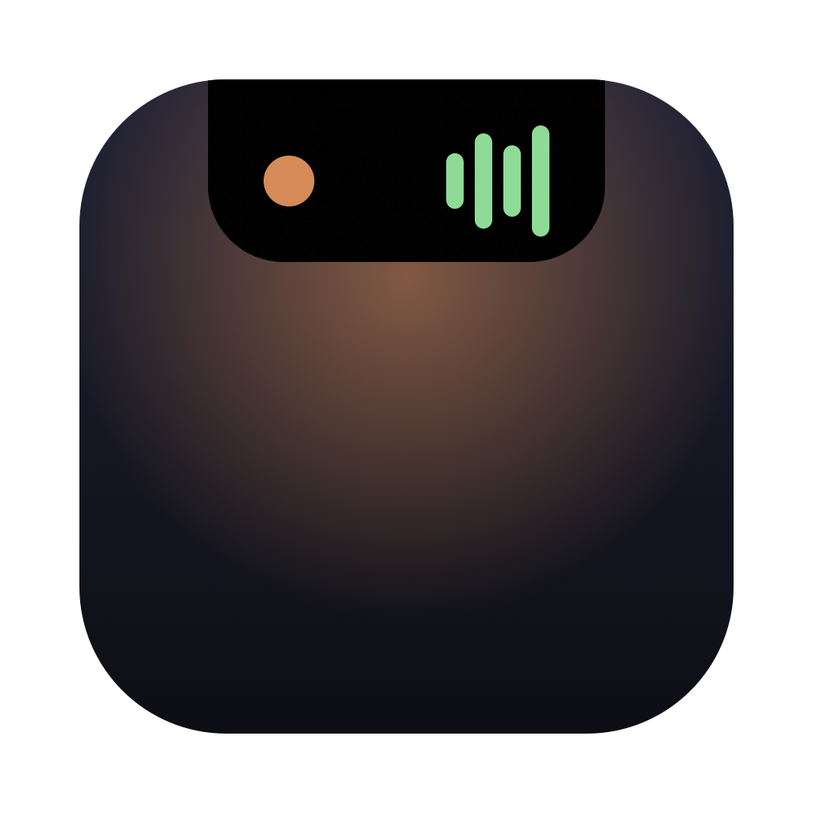
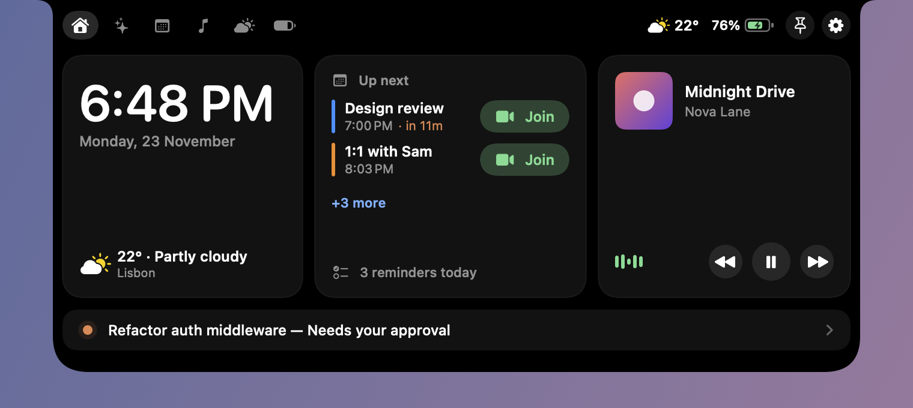
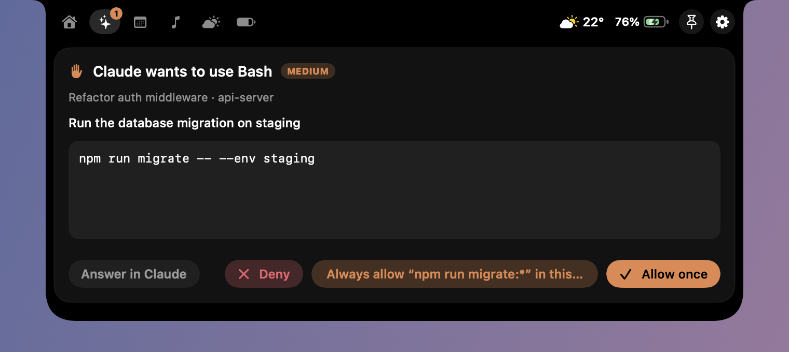
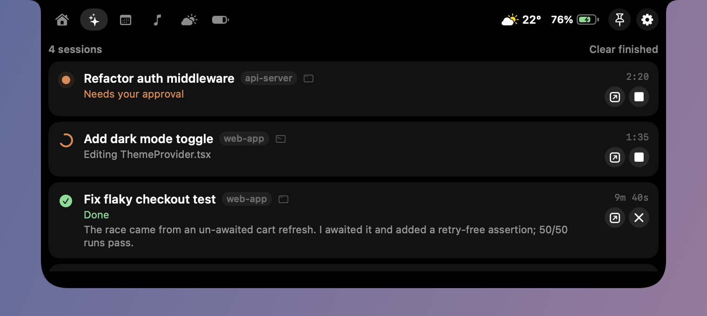
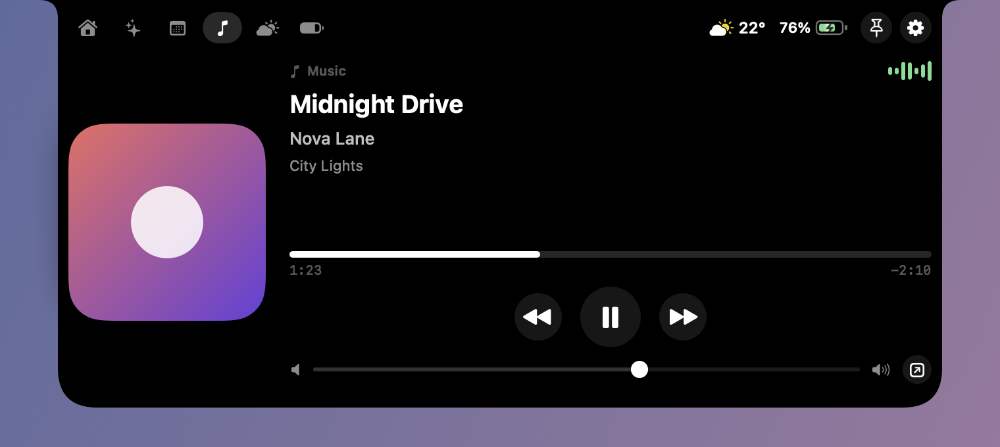
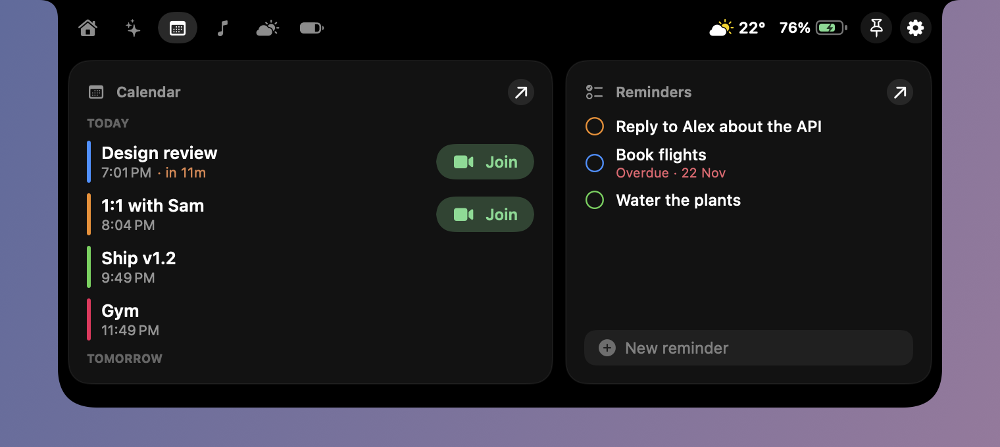
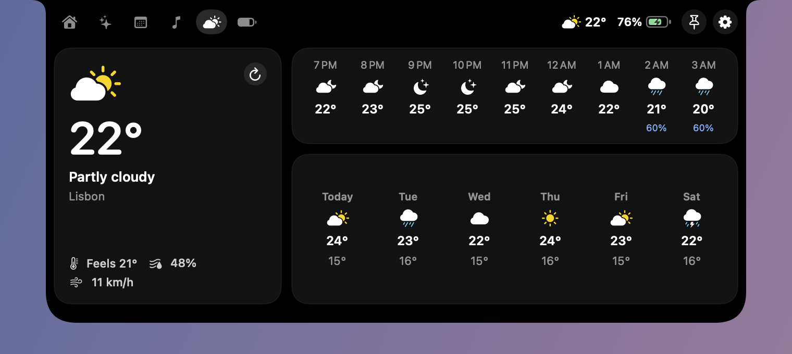
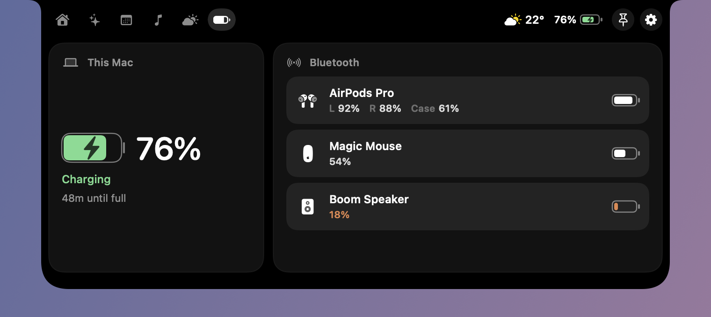

<div align="center">



# Peek

**Your MacBook's notch, put to work.**
Claude Code sessions and approvals, any-app Now Playing, calendar, weather and battery — one glance at the top of your screen.

[](https://github.com/luffy-taro-106/peek/actions/workflows/build.yml)
[](LICENSE)




</div>

---

## Features

### 🤖 Claude Code, from the notch
- **Every running session, live** — desktop app and terminal alike, including sessions started before Peek. Shows the chat title, project, what Claude is doing right now, and a timer.
- **Answer prompts without switching windows** — when Claude asks for permission, the notch opens on its own: **Allow once**, **Always allow** (Claude's own suggested rule), or **Deny**. It also answers multiple-choice questions and **plan approvals** (approve, approve + auto-accept edits, or keep planning).
- **Stop** a runaway session or **jump** to it in one click.
- **Fail-open by design** — if Peek isn't running, Claude Code behaves exactly as it always does.

<p align="center">
  
  
</p>

### 🎵 Now Playing — from any app
Music, Spotify, YouTube or Spotify in Chrome/Safari, podcasts, video players… with artwork, scrubbing, play/pause/skip, system volume and a live spectrum.

### 📅 Calendar & Reminders
Your next events across every calendar (iCloud, Google, Exchange…), one-click **Join** for Zoom, Meet, Teams, Webex and more, plus today's and overdue reminders — tick them off or add new ones.

### 🌤 Weather
Current conditions, a 12-hour strip and a 6-day forecast from [Open-Meteo](https://open-meteo.com) (free, no account). Uses your location or a city you pick; °C or °F.

### 🔋 Battery & Bluetooth
A charging animation when you plug in or unplug, low-battery alerts, and a banner with battery levels — AirPods left/right/case, speakers, mice, keyboards — the moment a device connects.

<p align="center">
  
  
</p>
<p align="center">
  
  
</p>
<p align="center">
  
  
</p>

### ✨ Feels native
Hover to open, move away to close. Click the pin to keep it open, or press <kbd>⌃</kbd><kbd>⌥</kbd><kbd>N</kbd> from anywhere. Lives in the menu bar and launches at login if you want. Using an external monitor? Choose where the notch appears in *Settings › General › Show on* — the main display (default), the built-in screen, or whichever display your pointer is on. Screens without a notch get one drawn at the top center.

---

## Install

**Requirements:** an Apple Silicon Mac on **macOS 14 Sonoma or later**, and Xcode *or* just the Command Line Tools (`xcode-select --install`).

```bash
git clone https://github.com/luffy-taro-106/peek.git
cd peek
make install        # builds Peek.app and copies it to ~/Applications
open ~/Applications/Peek.app
```

Prefer a download? Grab the zip from [Releases](https://github.com/luffy-taro-106/peek/releases). It isn't notarized, so the first time **right-click Peek.app → Open**.

### Keep permissions across updates (recommended if you build from source)
macOS remembers permissions by an app's code signature. Ad-hoc builds get a new signature every time, so macOS forgets what you allowed. Create a free local signing certificate once and every future build keeps its permissions:

```bash
make cert
```

---

## Connect Claude Code

Open the notch → **Claude** tab → **Connect Claude Code** (or *Settings › Claude › Install hooks*).

Peek adds a small hook script (`~/.local/bin/peek-hook`) to `~/.claude/settings.json` — a timestamped backup is saved next to it, and your other hooks are left untouched. Running sessions pick the change up automatically.

How it works:

```
Claude Code ──hook──▶ peek-hook (curl) ──▶ Peek on 127.0.0.1:8799 ──▶ notch
     ▲                                                     │
     └──────────── Allow / Deny / answer (JSON) ◀──────────┘
```

- The server only listens on `127.0.0.1` (loopback) — nothing is reachable from your network.
- If Peek isn't running, the hook exits instantly and prints nothing, so Claude shows its own prompt as usual.
- Sessions are also discovered from running `claude` processes and their transcripts in `~/.claude/projects`, so you see everything even without hooks.

To remove the hooks: *Settings › Claude › Remove hooks*, or `make uninstall`.

---

## Privacy

Everything stays on your Mac. Peek has no analytics, no accounts and no servers.

| Data | Where it goes |
|---|---|
| Claude sessions & prompts | Read locally; never leaves your Mac |
| Calendar & reminders | Read locally via EventKit |
| Now Playing | Read locally via MediaRemote / AppleScript |
| Location | Rounded to ~1 km and sent only to Open-Meteo to fetch the forecast |
| Bluetooth | Read locally from `system_profiler` / IOKit |

Each macOS permission is asked for only when you use the feature that needs it.

---

## Troubleshooting

<details>
<summary><b>Permissions keep resetting after every build</b></summary>

Run `make cert` once (see above), then rebuild. `./build.sh` prints `Signing with "Peek Local Signing"` when it's working.
</details>

<details>
<summary><b>Now Playing shows nothing for my browser</b></summary>

Peek reads system-wide Now Playing info through a tiny helper that runs inside `/usr/bin/perl` (macOS only shares this data with Apple-signed processes). Check *Settings › Music*: it should say "Any app (MediaRemote)". If macOS blocks it in a future release, Peek falls back to Music and Spotify via AppleScript.
</details>

<details>
<summary><b>Claude prompts don't appear in the notch</b></summary>

Make sure hooks are installed (*Settings › Claude*) and try *Send a test request*. If another notch app also installed Claude hooks, Claude waits for both — Peek offers to remove the other app's hooks.
</details>

<details>
<summary><b>Debug: what does Peek see?</b></summary>

```bash
curl -s http://127.0.0.1:8799/state | python3 -m json.tool
```
</details>

---

## Development

```bash
make build      # build/Peek.app
make run        # build, install to ~/Applications and launch
make previews   # re-render the README screenshots from the real views (sample data)
make icon       # regenerate the app icon
```

The code is a single SwiftPM target — no Xcode project needed. See [docs/ARCHITECTURE.md](docs/ARCHITECTURE.md) for how the pieces fit together, and [CONTRIBUTING.md](CONTRIBUTING.md) to get involved.

## Contributing

Bug reports, ideas and pull requests are very welcome — please read [CONTRIBUTING.md](CONTRIBUTING.md) and our [Code of Conduct](CODE_OF_CONDUCT.md). Security issues: see [SECURITY.md](SECURITY.md).

## License

[MIT](LICENSE). Weather data by [Open-Meteo](https://open-meteo.com) (CC BY 4.0).

Peek is an independent project and is not affiliated with Anthropic or Apple.
